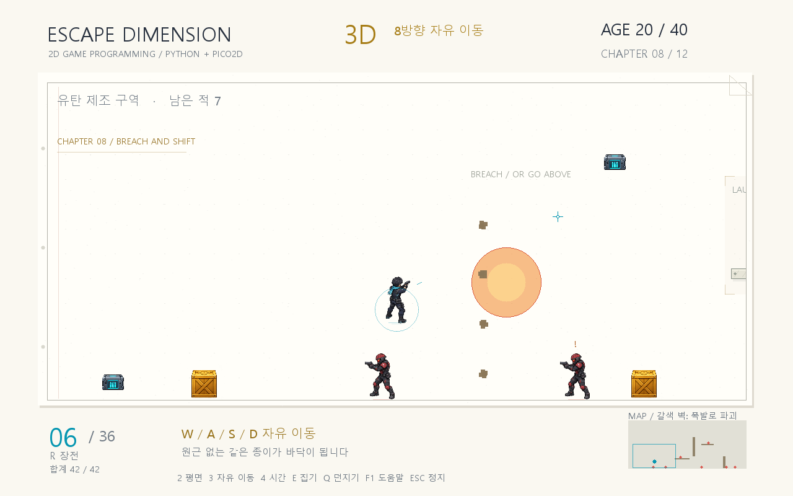

# Escape Dimension

메모지 같은 공간에서 이동·중력·시간 규칙을 바꾸며 적을 섬멸하는 2D 액션 슈팅 게임

게임공학과 박태욱 · 2D 게임프로그래밍 프로젝트


## 게임 개요

- 개발: Python, pico2d / Windows / 1280 × 800 창 모드
- 목표: 12개 챕터를 통과하고 6챕터 중간보스·12챕터 최종보스 처치
- 공간: 기존보다 약 4~6배 넓은 방, 추적 스크롤 카메라와 미니맵
- 2D: 좌우 이동, 낮은 점프, 중력과 상자 낙하 공격
- 3D: 같은 화면을 바닥으로 해석하는 8방향 이동
- 4D: 멈추면 세계 정지, 최근 4초의 과거 위치를 선택해 이동

모든 화면과 충돌 처리는 2D로 구현합니다. 3D·4D는 이동·중력·시간 규칙을 구분하는 게임 모드입니다.
탄창은 6발, 예비탄은 36발로 시작하며 보유량은 합계 최대 42발입니다.
4D는 최대 10초이고 종료하면 한 살을 먹습니다. 20세에 시작하며 40세 이상이면 처음부터 다시 시작합니다.

## 12챕터와 파괴 가능한 전장

시작 화면에서 좌우 방향키로 1~12챕터 중 시작할 곳을 고를 수 있습니다.
각 챕터의 적을 모두 처치한 뒤 Enter를 누르거나 출구에 도착하면 다음 챕터로 넘어갑니다.

| 구간 | 구성 |
|---|---|
| 1~5챕터 | 진입 구역, 폭파 창고, 갈라진 서고, 수직 기록실, 중앙 통로 |
| 6챕터 | 중간보스 **경계의 기록관**, 체력 18, 부채꼴 사격과 유탄 연사 |
| 7~11챕터 | 동력실, 유탄 제조 구역, 회랑, 시간 실험실, 마지막 격벽 |
| 12챕터 | 최종보스 **차원의 감시자**, 체력 36, 체력에 따른 3단계 공격 |

유탄병은 폭발 위치를 예고한 뒤 유탄을 발사합니다. 폭발이 내부 벽·선반·상자 근처에 닿으면 해당 장애물이 부서지고 파편이 발생합니다. 길이 열리면 적도 새 경로로 추적합니다.
바깥 경계는 유지하며, 사망 후 재도전하면 해당 챕터의 벽과 적이 처음 상태로 복구됩니다.

유탄의 이동·신관과 폭발·파편도 4D 시간 정지의 영향을 받습니다.
보스는 한 발에 쓰러지지 않으며 조준선과 공격 예고를 보고 차원을 바꾸거나 피해야 합니다.



## 조작

| 입력 | 기능 |
|---|---|
| A / D, Space | 2D 좌우 이동, 점프 |
| W / A / S / D | 3D·4D 이동, 동시 입력으로 대각선 이동 |
| 마우스, 왼쪽 버튼 | 조준, 발사 |
| R | 장전, 이동 중에도 가능 |
| 2 / 3 / 4 | 차원 모드 전환 |
| E / Q | 가까운 상자 집기, 조준 방향으로 투척 |
| 휠 또는 좌우 방향키, Enter | 4D의 과거 위치 선택, 시간 이동 |
| Enter | 시작, 방 진행, 재도전 |
| 시작 화면의 좌우 방향키 | 시작할 챕터 선택 |
| F1 / Esc / M | 도움말, 일시정지, 효과음 켜기·끄기 |

2D에서는 하체가 좌우를 향하고 상체와 팔이 상하 조준을 따라 움직입니다.
3D·4D에서는 8방향을 바라봅니다. 빠른 칼 적과 추적 적은 벽·상자의 모서리를 우회합니다.

## 실행 방법

Python 3.10 이상과 Windows 환경을 사용합니다. 이 PC에서는 Python 3.14.3으로 확인했습니다.

`실행.bat`을 더블 클릭하면 `.venv`를 준비하고 `main.py`를 실행합니다.
명령으로 실행하려면 다음을 사용합니다.

```powershell
python tools/setup_runtime.py
.venv\Scripts\python.exe main.py
```

이미 환경을 설치했다면 `python main.py`로 실행할 수 있습니다.
필요한 패키지 버전은 [requirements.txt](requirements.txt)에 고정했습니다.

중간보스나 최종보스를 바로 실행하려면 `python main.py --chapter 6` 또는 `python main.py --chapter 12`를 사용합니다.

## 소스 구조

| 경로 | 내용 |
|---|---|
| [main.py](main.py) | 진입점, pico2d 렌더링, 입력, UI, 효과음 |
| [core.py](core.py) | 이동, 전투, 중력, 시간, 노화, 방 진행 |
| [navigation.py](navigation.py) | 벽·상자 모서리를 이용하는 우회 경로 |
| [visuals.py](visuals.py) | 방향과 모션 프레임, 상체 조준 변형 |
| [camera.py](camera.py) | 스크롤 카메라와 화면·월드 좌표 변환 |
| [levels.json](levels.json) | 방·적·상자·장애물 배치 |
| [assets/](assets/) | 캐릭터·상자 이미지와 효과음 |
| [tests/](tests/) | 게임 규칙 검사 |
| [tools/](tools/) | 환경 설치, 빌드, 렌더링과 검사 도구 |
| [docs/](docs/) | 게임 화면과 구현 기록 |
| [GAME_DESIGN.md](GAME_DESIGN.md) | 게임 규칙과 설계 |

## 개발 검사

```powershell
.venv\Scripts\python.exe -m unittest discover -s tests
.venv\Scripts\python.exe tools/verify_game.py
```

게임 규칙과 실제 SDL 입력·렌더링을 검사합니다. `python tools/verify_campaign.py`로 12챕터·보스·벽 파괴·스크롤 조준도 확인합니다. 검사 기록은 [verification/](verification/)에 보관합니다.

## 게임 파일과 커밋 기록

[Escape Dimension.zip](Escape%20Dimension.zip)은 게임 개발 파일만 묶은 다운로드입니다.
소스·최신 실행 파일·에셋·맵·개발 문서·테스트·설치 wheel과 게임 개발 이력을 복원할 수 있는 Git bundle을 담았습니다.
GitHub 커밋 기록에도 기존 개발 커밋 50개와 후속 개발 이력을 보존했습니다.
압축 안의 README에 백업 복원 방법을 적었습니다.

## 리소스 출처

| 리소스 | 출처 |
|---|---|
| 캐릭터, 모션, 칼 적, 상자와 보급품 이미지 | OpenAI image_gen으로 제작 |
| 메모지 공간, 조준선, 탄환과 UI | pico2d·SDL의 2D 그리기로 구현 |
| 효과음 13종 | 사인파·잡음과 감쇠를 조합해 직접 합성 |
| 한글 글꼴 | 실행 PC의 Windows 맑은 고딕 사용, 글꼴 파일 미포함 |

자세한 제작 기록은 [ASSET_PROVENANCE.md](ASSET_PROVENANCE.md), 사용한 패키지의 라이선스는 [THIRD_PARTY/](THIRD_PARTY/)에 있습니다.
