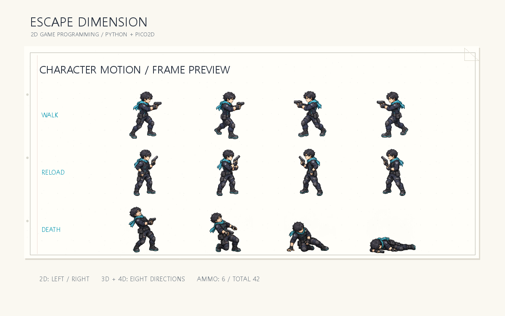
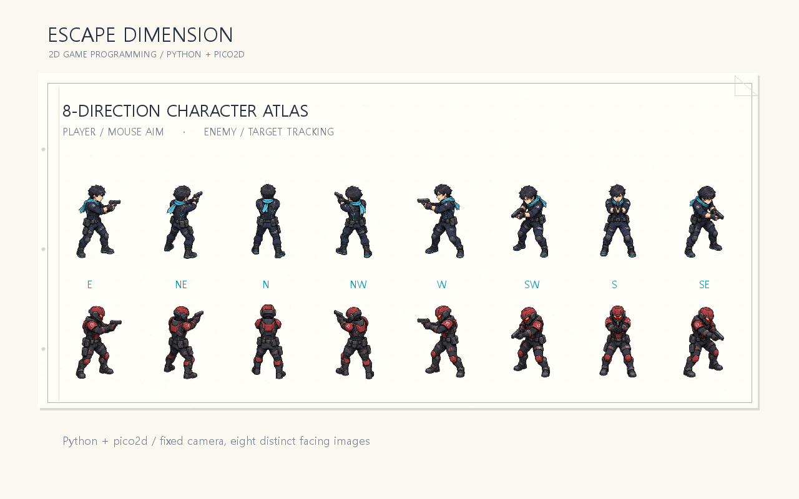
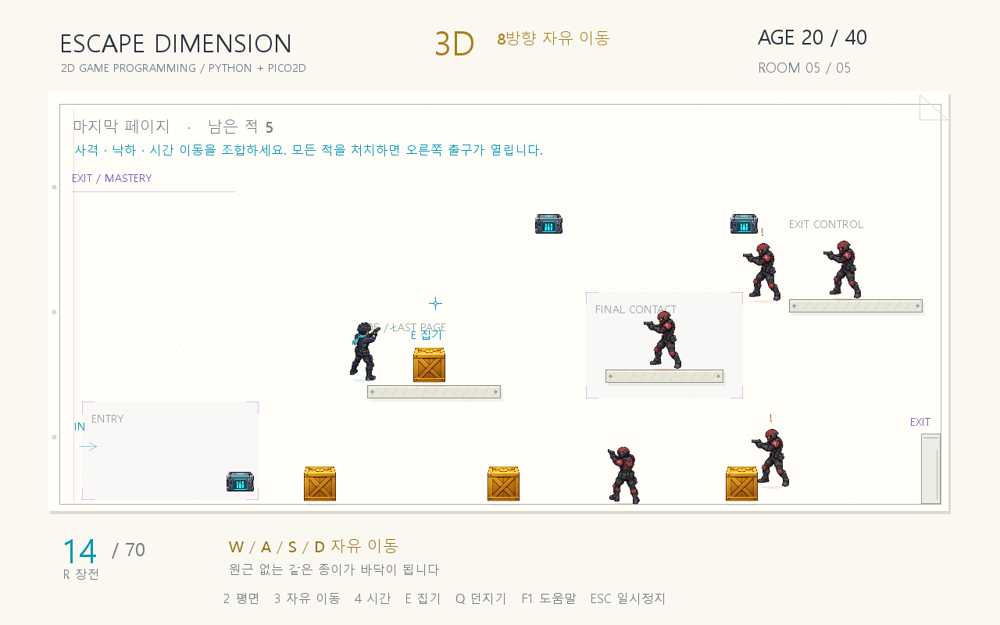

# Escape Dimension

메모지처럼 빈 방에서 이동·중력·시간 규칙을 바꾸며 적을 섬멸하는 **Python + pico2d 2D 게임 프로토타입**입니다.

## 최신 모션·전투 규칙

- 플레이어와 추적 적은 발을 번갈아 내딛는 걷기 프레임을 사용합니다.
- R 장전 시 탄창을 꺼내고 끼우는 두 단계 모션을 재생합니다.
- 플레이어와 적은 피격 후 4단계로 쓰러집니다. 플레이어의 0.8초 사망 동작이 끝난 뒤 재도전 안내가 나타납니다.
- 2D에서는 좌우 두 방향으로 바라보고 사격합니다. 3D·4D에서는 마우스 방향에 따라 8방향을 바라보고 모든 각도로 사격합니다.
- 적 탄환 속도는 방에 따라 320~420px/s이며, 이전 185~245px/s보다 약 1.7배 빠릅니다.
- 탄창 6발 + 시작 예비탄 36발 = **총 42발**입니다. 탄창과 예비탄을 합쳐 최대 42발을 보유합니다.
- 탄약이 가득 차면 보급품을 소비하지 않습니다. 공간이 생긴 뒤 가까이 가면 최대치까지만 보충합니다.



## 2026-11-13 개선

- 플레이어와 적에 앞·뒤·좌우·대각선 **8방향 전용 이미지** 적용. 플레이어는 마우스 조준 방향을 바라봅니다.
- 모든 방의 초기 상자를 바닥이나 선반에 안정적으로 배치하고, 방 로드·재도전 시 낙하 피해를 발생시키지 않습니다.
- 5개 방의 선반·상자·적 배치를 재설계하고, 입구·출구·우회 경로·엄폐 구역을 표시했습니다.
- 방 진입, 초기 적 생존, 동선, 실제 입력·방향별 렌더링을 검사합니다.





## 바로 실행

게임 실행 진입점은 **`main.py`**입니다. `실행.bat` 또는 상위 폴더의 `게임 실행.bat`도 `main.py`를 실행합니다. 게임 창은 1280×800입니다.

이 PC의 Python 3.14.3을 사용해 프로젝트 전용 `.venv` 환경을 준비하고 **pico2d 1.5.1, PySDL2 0.9.17, SDL DLL 2.32.10**을 설치했습니다. 게임 폴더에서 다음 명령으로 실행합니다.

```powershell
python main.py
```

`main.py`는 프로젝트의 `.venv`를 자동으로 사용합니다. 따라서 소스와 `levels.json`을 수정하면 다음 실행에 바로 반영됩니다. 다운로드한 설치용 wheel 파일은 `.runtime/wheels/`에 보관해 두었습니다. Python과 `.venv`는 별도 환경 설치 파일이며 소스 코드와 함께 Git에 올리지 않습니다.

시작 화면에서 **Enter**를 누릅니다. **F1**으로 조작 안내를 열고 닫습니다. 창의 닫기 버튼으로 종료할 수 있습니다.

## 조작

| 입력 | 기능 |
|---|---|
| A / D | 2D 좌우 이동 |
| W / A / S / D | 3D·4D 자유 이동, 동시 입력으로 대각선 이동 |
| 마우스 / 왼쪽 버튼 | 조준 / 발사 |
| R | 장전 |
| E / Q | 가까운 상자 집기 / 조준 방향으로 던지기 |
| 2 / 3 / 4 | 평면 / 자유 이동 / 시간 모드 |
| 휠·좌우 방향키 | 4D에서 과거 위치 선택 |
| Enter | 시작·시간 이동·방 진행·재도전 |
| Esc | 일시정지·계속하기, 도움말 닫기 |
| M | 효과음 켜기·끄기 |

## 규칙

- **2D:** 화면 세로 좌표는 높이입니다. 좌우로만 움직이고 바라보며 수평으로 사격합니다. 플레이어·적·상자는 중력에 따라 아래로 떨어집니다. 정지한 상자와 얇은 구조물은 발판이나 엄폐물입니다.
- **3D:** 같은 화면을 바닥으로 해석합니다. 상하좌우·대각선으로 움직이고 상자는 바닥 위치에서 유지됩니다. 실제 3D 엔진이나 모델을 쓰지 않습니다.
- **상자 공격:** 자유 이동으로 물체를 적보다 화면 위쪽에 배치하고 2D로 바꾸면 떨어뜨릴 수 있습니다. E로 집고 Q로 던질 수도 있습니다. 빠르게 움직이는 상자는 적을 처치합니다.
- **4D:** 실제 위치가 멈추면 적·탄환·물체·장전 진행도 정지합니다. 움직이면 세계가 진행합니다. 자기 탄환도 정지하므로 멈춘 채 발사한 탄환은 움직일 때 다시 진행합니다.
- **시간 이동:** 최근 4초의 위치를 선택합니다. 휠이나 방향키로 고르거나 화면 아래 시간축·잔상을 클릭한 뒤 Enter를 누릅니다. 물체·적과 겹치는 위치는 빨갛게 표시하고 이동을 거부합니다. 선택을 실행하면 즉시 3D로 돌아옵니다.
- **시간의 대가:** 4D는 최대 10초이고, 세계 정지 중에도 이 제한은 감소합니다. 수동 종료와 시간 이동도 종료에 포함해 한 살을 먹습니다. 플레이어 위치만 복원하고 탄약·적의 생사·나이는 유지합니다.
- **탄약:** 탄창 6발, 시작 예비 탄약 36발로 합계 최대 42발입니다. 보급품은 최대 28발을 보충하되 합계 42발을 넘지 않으며, 가득 차면 그대로 남습니다. 장전은 기본 1.25초입니다.
- **사망:** 적 탄환이나 적과 접촉하면 한 번에 사망합니다. Enter로 실패한 방 진입 전 상태와 탄약을 복구합니다. 나이는 유지됩니다. 방 진입 시 1.2초의 준비 시간을 둡니다.
- **연속 사망:** 같은 방에서 기본 나이 비용이 +1, +2, +4, +8…로 증가합니다. 다음 방에 들어가면 연속 횟수가 초기화됩니다.
- **예외 규칙안:** 4D 중 사망하면 4D 종료 비용 +1세와 사망 비용을 함께 적용합니다. 이 부분은 원 기획에서 미정이었던 예외를 프로토타입에서 명시한 것입니다.
- **끝:** 20세로 시작하며 40세 **이상**이면 전체 게임오버입니다. 다섯 방을 통과하면 클리어합니다. 방을 섬멸한 뒤 Enter 또는 오른쪽 출구로 다음 방에 갑니다. 4D에서는 Enter가 시간 이동이므로 먼저 2/3으로 전환하세요.

| 나이 | 과거 선택 간격 | 이동 속도 |
|---|---|---|
| 20~24 | 0.5초 | 100% |
| 25~29 | 0.4초 | 95% |
| 30~34 | 0.25초 | 90% |
| 35~39 | 0.1초 | 80% |

선택 간격·속도·적 행동 수치는 초기 밸런스안입니다. 현재 위치와 동일한 기록은 잔상 중복을 줄이기 위해 묶습니다. 움직임 기록이 짧으면 선택 가능한 과거 위치가 적습니다.

## 소스로 실행·수정

Python 3.10 이상이 필요하며, 현재 소스 실행은 Python 3.14.3으로 확인했습니다. 다른 환경에서 준비하거나 라이브러리를 복구할 때:

```powershell
python tools/setup_runtime.py
python main.py
```

- `main.py`: pico2d 표시·키보드·마우스·소리·UI
- `core.py`: 그래픽과 분리한 전투·중력·시간·노화·진행 규칙
- `levels.json`: 다섯 방의 이름·적 좌표·상자·장애물·보급
- `assets/sprites.png`: 3열×2행 스프라이트 시트
- `assets/characters_8dir.png`: 플레이어·적 8방향, 4열×4행 알파 투명 시트
- `assets/walk_player.png`, `walk_enemy.png`: 8방향 × 2걷기 프레임
- `assets/reload_player.png`: 8방향 × 2장전 프레임
- `assets/death_both.png`: 플레이어·적 × 좌우 × 4사망 프레임
- `visuals.py`: 마우스 방향 판별과 시트 좌표 계산
- `assets/*.wav`: 원본 합성 효과음 11종
- `tests/`: 규칙·방 시작·탄약 제한·동선·방향·모션 검사 36개

기본 실행은 `main.py`이므로 별도 EXE 빌드 없이 수정 사항을 확인할 수 있습니다. 기존 `EscapeDimension.exe`를 따로 실행할 때는 빌드 당시의 소스와 데이터가 사용됩니다.

## 검사

```powershell
.venv\Scripts\python.exe -m unittest discover -s tests -v
python main.py --smoke --capture gameplay.png
python main.py --self-test --test-report input-tests.json
.venv\Scripts\python.exe tools/verify_game.py
```

규칙 테스트는 위치 복원·정지·사망·탄약·낙하·엄폐·빠른 탄환 충돌·방 진행을 검사합니다. SDL 입력 검사는 이 게임의 SDL 이벤트 큐에 키·마우스 입력을 넣어 메뉴·모드·시간 이동·장전·집기·투척·재시작을 검증합니다. 다른 프로그램을 제어하지 않습니다.

추가로 5개 방에서 시작 직후 적이 자연 낙하로 사망하지 않는지, 상자가 안정적으로 놓이는지, 재도전 시 적이 모두 복구되는지 검사합니다. 8방향 마우스 입력은 렌더러에서 선택한 프레임까지 확인합니다. 검사 기록은 `verification/`에 보관합니다.

## 실행 파일 다시 빌드

EXE 배포가 필요할 때만 사용하는 선택 작업입니다. 기본 `main.py` 실행에는 PyInstaller가 필요하지 않습니다. 기존 EXE는 Python 3.12 환경으로 빌드와 실행을 검증했습니다.

```powershell
.venv\Scripts\python.exe -m pip install -r requirements-build.txt
.venv\Scripts\python.exe tools/build_game.py
```

완료하면 프로젝트 루트의 `EscapeDimension.exe`가 갱신됩니다. 이 파일과 빌드 캐시는 Git에서 제외하고 소스·원본 에셋·검사 기록을 커밋합니다. 변경 이력은 `CHANGELOG.md` 또는 `git log --oneline`으로 확인할 수 있습니다.

## 현재 범위

다섯 방을 연결한 기능 프로토타입입니다. 8방향 이미지, 2프레임 걷기·장전, 4프레임 사망 모션과 효과음을 포함합니다. 더 부드러운 다중 프레임 애니메이션, 배경음악과 세부 밸런스 조정은 후속 작업입니다. 진행 저장·온라인 기능은 없습니다.

그래픽은 대화에서 만든 메모지형 콘셉트를 바탕으로 내장 이미지 생성 도구로 제작한 스프라이트이며, 실행 화면은 실제 pico2d 프레임버퍼에서 캡처했습니다. 효과음은 사인파와 잡음으로 직접 합성했습니다. 배경은 빈 종이와 얇은 경계로 구성해 같은 공간을 높이와 바닥 양쪽으로 해석하게 합니다.

라이브러리: [pico2d](https://pypi.org/project/pico2d/), [PySDL2](https://pysdl2.readthedocs.io/), [PySDL2 DLL](https://pypi.org/project/PySDL2-dll/). 제삼자 고지와 라이선스는 `THIRD_PARTY/`를 확인하세요.
