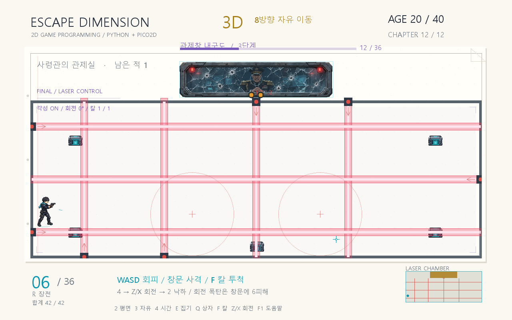
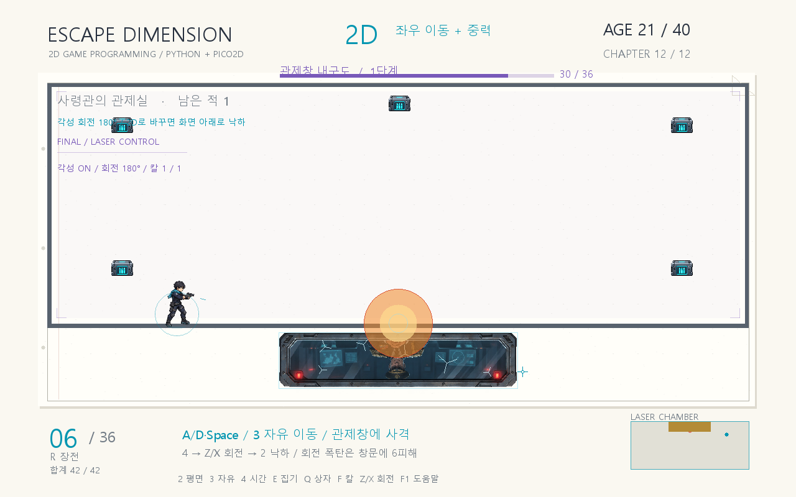

# Escape Dimension

메모지 같은 공간에서 이동·중력·시간 규칙을 바꾸며 적을 섬멸하는 2D 액션 슈팅 게임

게임공학과 박태욱 · 2D 게임프로그래밍 프로젝트



## 게임 개요

- 개발: Python, pico2d / Windows / 1280 × 800 창 모드
- 목표: 12개 챕터를 통과하고 6챕터 중간보스·12챕터 최종보스 처치
- 공간: 기존보다 약 4~6배 넓은 방, 추적 스크롤 카메라와 미니맵
- 2D: 좌우 이동, 낮은 점프, 중력과 상자 낙하 공격
- 3D: 같은 화면을 바닥으로 해석하는 8방향 이동
- 4D: 멈추면 세계 정지, 최근 4초의 과거 위치를 선택해 이동
- 각성: 6챕터 클리어 후 4D 공간 회전과 2D 중력을 조합해 폭탄 반격
- 낙하 무기: 상자와 소지한 칼 1자루, 실제 낙하 거리 80px 이상에서 피해

모든 화면과 충돌 처리는 2D로 구현합니다. 3D·4D는 이동·중력·시간 규칙을 구분하는 게임 모드입니다.
탄창은 6발, 예비탄은 36발로 시작하며 보유량은 합계 최대 42발입니다.
4D는 최대 10초이고 종료하면 한 살을 먹습니다. 20세에 시작하며 40세 이상이면 처음부터 다시 시작합니다.

## 12챕터와 파괴 가능한 전장

시작 화면에서 좌우 방향키로 1~12챕터 중 시작할 곳을 고를 수 있습니다.
각 챕터의 적을 모두 처치한 뒤 Enter를 누르거나 출구에 도착하면 다음 챕터로 넘어갑니다.

| 구간 | 구성 |
|---|---|
| 1~5챕터 | 진입 구역, 폭파 창고, 갈라진 서고, 수직 기록실, 중앙 통로 |
| 6챕터 | **엘리트 기관총 사수**, 체력 18, 조준 예고 뒤 12~18발 연사와 장전 대기 |
| 7~11챕터 | 동력실, 유탄 제조 구역, 회랑, 시간 실험실, 마지막 격벽 |
| 12챕터 | 창 너머의 **관제실 사령관**, 관제창 내구도 36, 사방 레이저 회피 |

유탄병은 폭발 위치를 예고한 뒤 유탄을 발사합니다. 폭발이 내부 벽·선반·상자 근처에 닿으면 해당 장애물이 부서지고 파편이 발생합니다. 길이 열리면 적도 새 경로로 추적합니다.
바깥 경계는 유지하며, 사망 후 재도전하면 해당 챕터의 벽과 적이 처음 상태로 복구됩니다.

유탄의 이동·신관과 폭발·파편도 4D 시간 정지의 영향을 받습니다.
중간보스는 벨트 급탄식 기관총을 사용하는 엘리트 군인입니다. 조준 예고가 끝나면 잠근 방향으로 연사하고 잠시 장전합니다. 체력이 절반 이하가 되면 연사가 길어집니다.

최종전에서는 창 너머의 사령관이 관찰하며 왼쪽·위·오른쪽·아래에서 레이저가 발사됩니다. 가는 예고선이 먼저 나오고 굵은 빔이 켜질 때 피해를 입습니다. 카메라는 전투장 전체에 고정됩니다.
플레이어는 레이저를 피하면서 위쪽 관제창을 총으로 쏴야 합니다. 총격이 누적되면 균열이 늘고 유리가 깨집니다. 창의 내구도가 낮아질수록 공격이 강화되며 마지막 단계에는 사방 레이저가 함께 발사됩니다. 창을 완전히 파괴하면 레이저와 폭탄 공격이 정지하고 승리합니다. 일반 유탄과 상자는 창에 피해를 주지 않으며, 각성으로 회전한 폭탄만 1회 폭발에 6피해를 줍니다.

레이저는 단계별 최대 3·5·7줄로 증가하며 약 0.8~0.9초의 예고 뒤 0.48초간 발사됩니다. 사령관은 1.9~2.7초 간격으로 폭탄을 던지고 마지막 단계에는 두 발씩 던집니다.

레이저 예고와 발사 시간, 폭탄 궤적과 신관도 4D에서 정지합니다. 활성 레이저에 겹치는 과거 위치로는 이동할 수 없습니다.


## 각성과 낙하 무기

6챕터의 적을 모두 처치하면 각성합니다. 4D에서 **Z는 왼쪽, X는 오른쪽으로 90도 회전**합니다. 한 세션 안에서 여러 번 회전할 수 있으며 기존 4D 종료 시 나이 +1 규칙을 유지합니다. 회전은 2D·3D로 바꿔도 유지되고 새 챕터와 재도전 시에는 0도로 돌아옵니다. 7~12챕터를 바로 고르면 각성이 해금된 상태로 체험합니다.

회전하면 공간의 시점과 중력 기준이 바뀌며 폭탄의 궤적을 꺾을 수 있습니다. 최종전에서 폭탄이 나온 뒤 `4 → X 두 번 → 2`를 사용하면 창문이 아래에 놓이고 폭탄이 창 쪽으로 떨어집니다. 폭발 지점과 플레이어 사이에는 거리를 확보해야 합니다. 90·270도에서는 전장 전체가 보이도록 카메라가 축소되며 조준과 이동도 회전된 화면을 따릅니다.

칼은 한 자루를 소지하며 **F로 조준 방향에 투척**, 가까이 가서 **E로 회수**합니다. 상자를 들고 있어도 칼 소지는 별도입니다. 상자와 칼은 빠른 수평 투척만으로 피해를 주지 않습니다. 2D 중력으로 실제 80px 이상 연속 낙하한 뒤 적에게 처음 닿아야 피해를 줍니다. 착지·집기·차원 또는 중력 변경 시 낙하 거리를 다시 측정합니다. 3D에서 적보다 높은 곳에 배치하거나 4D 회전을 활용하세요.



## 조작

| 입력 | 기능 |
|---|---|
| A / D, Space | 2D 좌우 이동, 점프 |
| W / A / S / D | 3D·4D 이동, 동시 입력으로 대각선 이동 |
| 마우스, 왼쪽 버튼 | 조준, 발사 |
| R | 장전, 이동 중에도 가능 |
| 2 / 3 / 4 | 차원 모드 전환 |
| E / Q | 가까운 상자 집기, 조준 방향으로 투척 / E는 칼 회수도 가능 |
| F | 소지한 칼 1자루 투척 |
| Z / X | 각성 후 4D에서 공간을 왼쪽 / 오른쪽으로 90도 회전 |
| 휠 또는 좌우 방향키, Enter | 4D의 과거 위치 선택, 시간 이동 |
| Enter | 시작, 방 진행, 재도전 |
| 시작 화면의 좌우 방향키 | 시작할 챕터 선택 |
| F1 / Esc / M | 도움말, 일시정지, 효과음 켜기·끄기 |

2D에서는 하체가 좌우를 향하고 상체와 팔이 상하 조준을 따라 움직입니다.
3D·4D에서는 8방향을 바라봅니다. 빠른 칼 적과 추적 적은 벽·상자의 모서리를 우회합니다.

## 실행 방법

Python 3.10 이상과 Windows 환경을 사용합니다. 이 PC에서는 Python 3.14.3으로 확인했습니다.

`실행.bat`을 더블 클릭하면 `.venv`를 준비하고 `main.py`를 실행합니다.
명령으로 실행하려면 다음을 사용합니다.

```powershell
python tools/setup_runtime.py
.venv\Scripts\python.exe main.py
```

이미 환경을 설치했다면 `python main.py`로 실행할 수 있습니다.
필요한 패키지 버전은 [requirements.txt](requirements.txt)에 고정했습니다.

중간보스나 최종보스를 바로 실행하려면 `python main.py --chapter 6` 또는 `python main.py --chapter 12`를 사용합니다.

## 소스 구조

| 경로 | 내용 |
|---|---|
| [main.py](main.py) | 진입점, pico2d 렌더링, 입력, UI, 효과음 |
| [core.py](core.py) | 이동, 전투, 중력, 시간, 노화, 방 진행 |
| [navigation.py](navigation.py) | 벽·상자 모서리를 이용하는 우회 경로 |
| [visuals.py](visuals.py) | 방향과 모션 프레임, 상체 조준 변형 |
| [camera.py](camera.py) | 스크롤·회전·축소 카메라와 조준 좌표 변환 |
| [space.py](space.py) | 시점과 물리에서 공유하는 직교 회전 좌표 |
| [levels.json](levels.json) | 방·적·상자·장애물 배치 |
| [assets/](assets/) | 캐릭터·상자 이미지와 효과음 |
| [tests/](tests/) | 게임 규칙 검사 |
| [tools/](tools/) | 환경 설치, 빌드, 렌더링과 검사 도구 |
| [docs/](docs/) | 게임 화면과 구현 기록 |
| [GAME_DESIGN.md](GAME_DESIGN.md) | 게임 규칙과 설계 |

## 개발 검사

```powershell
.venv\Scripts\python.exe -m unittest discover -s tests
.venv\Scripts\python.exe tools/verify_game.py
```

게임 규칙과 실제 SDL 입력·렌더링을 검사합니다. `python tools/verify_campaign.py`로 12챕터·보스·벽 파괴·스크롤 조준도 확인합니다. `python tools/verify_awakening.py`로 각성·회전·칼·폭탄 반격의 실제 SDL 입력도 검사합니다. 검사 기록은 [verification/](verification/)에 보관합니다.

`python tools/verify_boss_fights.py`는 기관총·유리 파괴 4단계·레이저 예고와 발사를 실제 렌더러로 검사합니다. `python tools/verify_commander_clear.py`는 무적 처리 없이 이동·사격·장전만 사용하는 회피 시뮬레이션입니다.

## 게임 파일과 커밋 기록

[Escape Dimension.zip](Escape%20Dimension.zip)은 게임 개발 파일만 묶은 다운로드입니다.
소스·최신 실행 파일·에셋·맵·개발 문서·테스트·설치 wheel과 게임 개발 이력을 복원할 수 있는 Git bundle을 담았습니다.
GitHub 커밋 기록에도 기존 개발 커밋 50개와 후속 개발 이력을 보존했습니다.
압축 안의 README에 백업 복원 방법을 적었습니다.

## 리소스 출처

| 리소스 | 출처 |
|---|---|
| 캐릭터, 모션, 칼 적, 상자와 보급품 이미지 | OpenAI image_gen으로 제작 |
| 메모지 공간, 소지·투척 칼, 조준선, 탄환과 UI | pico2d·SDL의 2D 그리기로 구현 |
| 효과음 18종 | 사인파·잡음과 감쇠를 조합해 직접 합성 |
| 한글 글꼴 | 실행 PC의 Windows 맑은 고딕 사용, 글꼴 파일 미포함 |

자세한 제작 기록은 [ASSET_PROVENANCE.md](ASSET_PROVENANCE.md), 사용한 패키지의 라이선스는 [THIRD_PARTY/](THIRD_PARTY/)에 있습니다.
